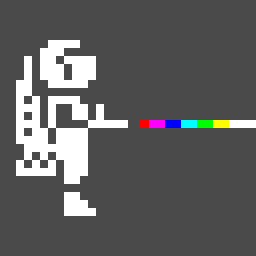

JET PAC
=====================
The 1983 classic, reborn for modern web browsers.

## About
Originally written in 1983 by Tim and Chris Stamper of Ultimate Play The Game
for the 16K ZX Spectrum. A faithful remake based on the original ZX Spectrum
version — not an emulator and not a binary copy.

**Status: playable** (M0–M6 done, M7 — tuning and release — under way). The
tape is taken apart, the program disassembled, and every rule in the game is a
transcription of the original's own handlers, checked against runs recorded
off it in a simulator. Every `match*` tool reports zero differences but one:
the entity table (`tools/matchentities.js`, 244 256 checks) differs in **two**
bytes of a laser shot, which on the original asks the video memory what is in
front of it. See `MILNIKY.md` for the numbers and `sources/docs/disasm_notes.md`
for what was measured.

- 256×192 + border, integer scaling, `ZXPlatform`
- graphics extracted from the original program, not redrawn; drawn
  incrementally as the original draws, with colour per pixel instead of the
  Spectrum's attribute clash (the video memory itself stays the original's,
  byte for byte)
- **LOAD TAPE**: the loader's own messages and the real loading screen off
  the tape, loaded byte by byte
- the beeper in Z80 T states, pulse for pulse (there is no music: the game
  has none)
- keyboard, gamepad, touch; one player (the original's two-player mode is
  left out on purpose); a hall of fame on the server

Still to come (M7): the two laser bytes, performance on a phone, release.

## Requirements
- PHP 8.1+
- nginx
- MySQL / MariaDB
- Node.js + terser, for building the bundle (`npm i -g terser`)
- es-check, for the ES2018 gate in `svtool verify` (`npm i -g es-check`)
- Python 3, only for the tools that extract and verify the data of the original

**LOAD TAPE** is one of the ways to start the game: the pilot tone, the border
stripes, the headers and the loading screen loaded for real, byte by byte,
because the sound *is* the 6912 bytes of the picture. That is why the tape
image (TZX/TAP) is the source this project is built from.

The original tape and cartridge images are copyrighted and are **not** part of
this repository — they are needed only to regenerate the game data, see
`sources/tape/README.md` and `sources/rom/README.md`.

## License
See the [LICENSE](LICENSE) file.
